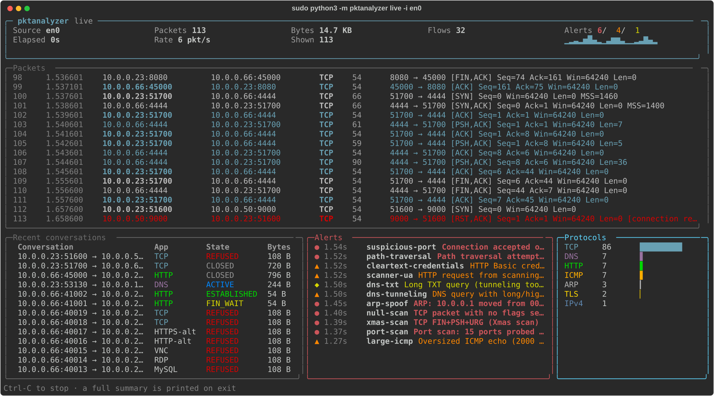
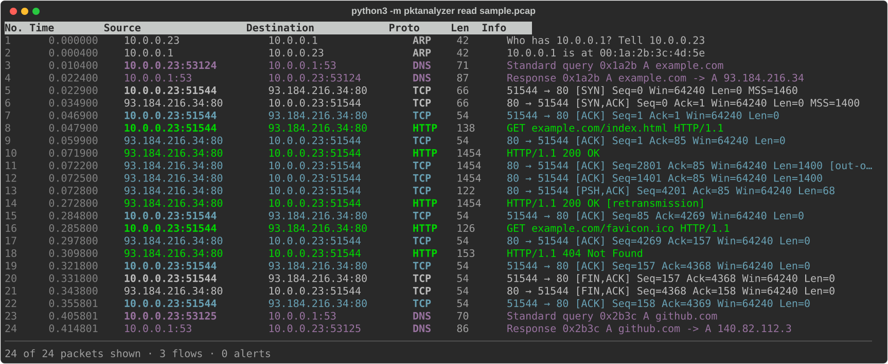
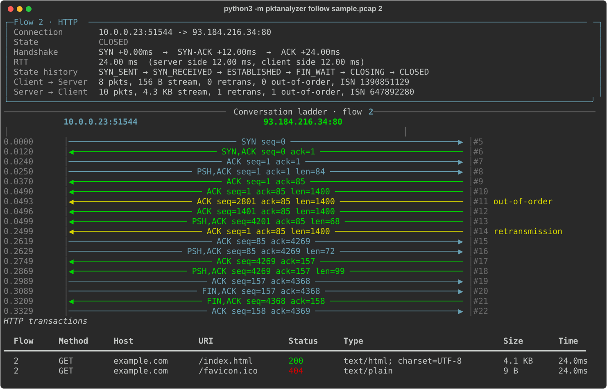
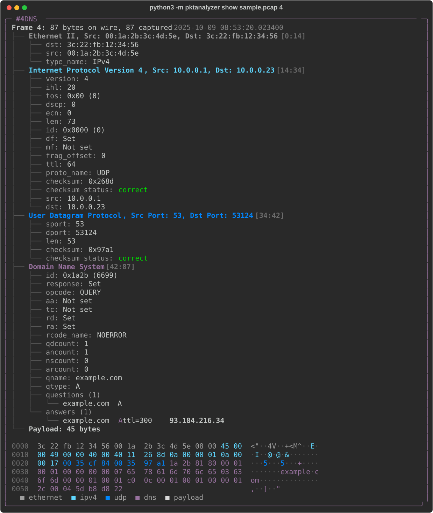
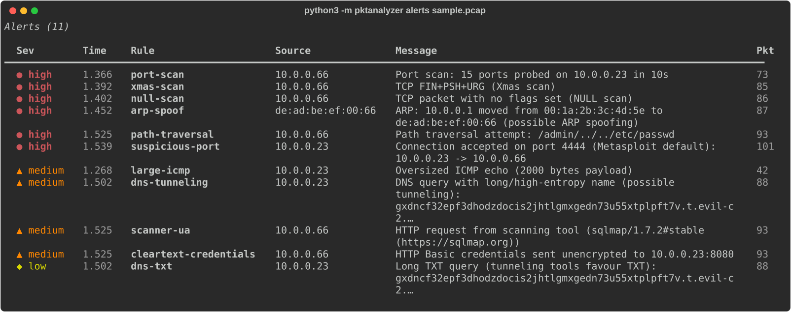

# pktanalyzer

A from-scratch network packet sniffer and protocol analyzer for the terminal: a lightweight Wireshark written in pure Python.

Every header is parsed by hand with `struct`. There's no scapy and no libpcap. The tool reads raw frames from a live raw socket or from a `.pcap`/`.pcapng` file, peels them apart layer by layer (Ethernet → IP → TCP/UDP → DNS/HTTP/TLS), rebuilds TCP conversations, flags suspicious traffic and exports everything it learned.



## Features

| Area | What it does |
|---|---|
| **Capture** | Live capture with raw sockets: `AF_PACKET` on Linux, the BPF device (`/dev/bpf*`) on macOS. It also reads pcap (µs/ns, either byte order) and pcapng, and writes pcap. |
| **Link / network** | Ethernet II, 802.1Q/QinQ VLANs, Linux cooked capture, BSD loopback, ARP, IPv4 (options, checksum validation), IPv6 (extension-header chain walking) |
| **Fragmentation** | Reassembles fragmented IPv4 and IPv6 datagrams, and detects overlapping fragments (teardrop) and oversize fragments (ping of death) |
| **Transport** | TCP (flags, options: MSS / window scale / SACK / timestamps, pseudo-header checksum), UDP, ICMP / ICMPv6. For ICMP errors it decodes the quoted packet, so you can see which connection failed. |
| **Application** | DNS (all common record types and name compression, with pointer-loop protection), HTTP/1.x (requests, responses, Content-Length and chunked bodies), TLS (SNI, ALPN, negotiated version and cipher suite, and for TLS 1.2 and older the full certificate chain via a hand-written DER/X.509 parser: subject, issuer, validity, SANs, key type and size, signature algorithm, SHA-1/SHA-256 fingerprints), DHCP |
| **TCP state machine** | A passive RFC 793 tracker: `SYN_SENT → SYN_RECEIVED → ESTABLISHED → FIN_WAIT → CLOSING → CLOSED`, plus `RESET` and `REFUSED`. It also handles captures that start mid-stream and port reuse. |
| **Handshake reconstruction** | Times SYN / SYN-ACK / ACK and splits the RTT into server-side and client-side halves |
| **Stream reassembly** | Reorders segments by sequence number (32-bit wraparound safe), trims overlaps, and counts retransmissions and out-of-order segments. The rebuilt stream feeds the HTTP parser. |
| **Filters** | Wireshark-style fields mixed with tcpdump shorthands (see below) |
| **Anomaly detection** | Port scans, host sweeps, UDP scans, SYN floods, NULL/Xmas/FIN/SYN+FIN scans, LAND, ARP spoofing, DNS tunneling (by name length and entropy), NXDOMAIN bursts, unsolicited DNS answers, scanner User-Agents, path traversal and SQLi/XSS in URIs, cleartext credentials (HTTP Basic, FTP, Telnet, POP3, IMAP), connections accepted on backdoor ports, fragment attacks, and TLS problems: expired, not-yet-valid or self-signed certificates, certificates that don't cover the requested name, weak ciphers (RC4, 3DES, NULL, EXPORT), deprecated protocol versions, weak keys and signatures, fatal handshake alerts |
| **Visualization** | A coloured packet list, a layer tree with a hex dump coloured by protocol layer, a TCP conversation ladder diagram, a protocol hierarchy, top talkers, and a full-screen live dashboard |
| **Timeline** | One clock for the whole capture: handshakes (with RTT), DNS lookups (with answer time), HTTP exchanges (with response time), TLS sessions, retransmissions, resets and alerts. A swimlane strip shows when each kind of activity happened, and bursts such as a port scan's 20 refusals collapse into one line. |
| **Risk scoring** | Every conversation gets a 0-100 score with its reasons: alerts on the flow, a scanning source, backdoor ports, an outbound call to one, shell commands in cleartext, high-entropy payload on a non-TLS port, upload-heavy byte ratios, retransmission rate and malformed packets. |
| **Host profiling** | Every address gets a profile: names (from DHCP, DNS answers, TLS SNI and HTTP Host), MAC, a passive OS guess from the initial TTL and SYN window/options, roles (gateway, DNS/web server, workstation, scanner, external), open and closed ports, services it uses, DNS lookups, TLS names and User-Agents, peers, alerts caused and received, and its riskiest conversation. |
| **Capture diff** | `diff before.pcap after.pcap` compares two captures by stable keys (client → server:port, DNS name + type, TLS SNI): new and missing conversations (a scan collapses to one line), conversations whose bytes, retransmissions, RTT or risk changed, changed DNS answers and new names, new, increased and resolved alerts, changed TLS servers and certificates, new hosts and newly open ports, protocol mix and per-host bandwidth. `--json` saves the result. |
| **Incident report** | `report` writes one self-contained HTML file (no scripts, no external assets, light and dark themes) with an executive summary, a timeline chart, every alert explained in plain language with a recommended action, suspicious hosts, top talkers, risk-ranked conversations, DNS, HTTP and TLS activity, and the JSON exports embedded as downloads. `alerts --explain` gives the same explanations in the terminal. |
| **Export** | `flows.json/csv`, `packets.jsonl`, `alerts.json`, `hosts.json`, `dns.json`, `http.json`, a filtered `packets.pcap`, and the reassembled TCP streams with extracted HTTP bodies |

## Install

```bash
cd packet_analyzer
pip3 install -r requirements.txt     # just `rich`
python3 -m pktanalyzer --help
```

It needs Python 3.10 or newer. You can also run `pip3 install -e .` to get a `pktanalyzer` command.

## Quick start (no root needed)

```bash
python3 -m pktanalyzer sample sample.pcap      # writes a demo capture with normal traffic and attacks
python3 -m pktanalyzer read sample.pcap        # packet list
python3 -m pktanalyzer stats sample.pcap       # summary: hierarchy, talkers, flows, HTTP, DNS, alerts
python3 -m pktanalyzer flows sample.pcap       # conversations with state and RTT
python3 -m pktanalyzer follow sample.pcap 2    # ladder diagram + reassembled HTTP stream
python3 -m pktanalyzer show sample.pcap 8      # full dissection + coloured hex dump of packet 8
python3 -m pktanalyzer alerts sample.pcap      # what looks suspicious
python3 -m pktanalyzer tls sample.pcap --certs # TLS versions, ciphers and certificate chains
python3 -m pktanalyzer risk sample.pcap        # conversations ranked by risk score, with reasons
python3 -m pktanalyzer timeline sample.pcap    # handshakes, DNS, HTTP, resets and alerts on one clock
python3 -m pktanalyzer hosts sample.pcap       # who is on the wire: role, OS guess, ports, lookups, alerts
python3 -m pktanalyzer hosts sample.pcap 10.0.0.23   # full profile of one host
python3 -m pktanalyzer sample --baseline before.pcap  # the same network on a quiet day
python3 -m pktanalyzer diff before.pcap sample.pcap   # what changed between the two captures
python3 -m pktanalyzer alerts sample.pcap -e   # alerts grouped by rule: why it matters, what to do
python3 -m pktanalyzer report sample.pcap -o report.html   # shareable HTML incident report
python3 -m pktanalyzer live -r sample.pcap     # replay it through the live dashboard
python3 -m pktanalyzer export sample.pcap -o out/
```

## Live capture (needs root)

```bash
sudo python3 -m pktanalyzer interfaces                    # list interfaces (* = default)
sudo python3 -m pktanalyzer live -i en0                   # full-screen dashboard
sudo python3 -m pktanalyzer capture -i en0 -f "dns or http" -w session.pcap
sudo python3 -m pktanalyzer capture -i en0 -c 50 -v       # first 50 packets, fully dissected
```

On macOS the interface is usually `en0` (Wi-Fi). On Linux it's usually `eth0` or `wlan0`. Checksum validation is off by default for live capture, because the network card fills in checksums for outgoing packets after the kernel hands them to us, so they would all look wrong. Pass `--checksums` to turn it on.

## Display filters

```text
tcp and port 443                          tcpdump-style shorthands
host 10.0.0.5 and not arp                 src/dst host, port, net, portrange
net 192.168.0.0/16
ip.src == 10.0.0.0/8 && tcp.flags.syn     field comparisons (CIDR works for addresses)
tcp.port == 80                            .port / .addr match either direction
dns.qname contains "google"
http.method == POST or http.status >= 400
http.user_agent matches "^curl"           regex (case-insensitive)
tcp.dport in {22 80 443}
frame.len > 1000
syn and not ack                           flag shorthands
alerts                                    packets that triggered an alert
flow 7                                    every packet of conversation 7
```

Operators: `== != > < >= <= contains matches ~ in`, combined with `and/&&`, `or/||`, `not/!` and parentheses. Any decoded field can be used. Run `show` on a packet to see the field names (for example `ipv4.ttl`, `tcp.window`, `dns.rcode_name`, `tls.sni`, `http.host`).

## How it works

```text
pktanalyzer/
├── pcap.py       pcap/pcapng reader + writer (format sniffing, timestamp resolution)
├── capture.py    raw-socket capture: AF_PACKET (Linux) and BPF ioctls (macOS)
├── packet.py     Packet/Layer model and dotted field lookup used by filters
├── decoder.py    link → network → transport decoders, checksums, IP defragmentation
├── dns.py        DNS message parser with compression pointers
├── http.py       per-packet HTTP header parser + incremental stream parser
├── tls.py        TLS records, hellos, cipher suites, stream parser for certificate messages
├── x509.py       DER/ASN.1 reader for X.509 certificates
├── flows.py      flow table, passive TCP state machine, handshake timing, reassembly
├── anomalies.py  sliding-window detectors that raise rate-limited alerts
├── filters.py    tokenizer + recursive-descent parser → predicate closures
├── analyzer.py   pipeline (decode → track → detect → stats) and the Info column
├── scoring.py    0-100 risk score per conversation, built from explainable evidence
├── timeline.py   time-ordered event view (handshakes, DNS, HTTP, TLS, resets, alerts)
├── hosts.py      per-host profiles: names, MAC, OS guess, roles, services, lookups, alerts
├── diff.py       compares two captures (flows, DNS, TLS, alerts, hosts, ports, bandwidth)
├── explain.py    plain-language "why it matters / what to do" for every alert rule
├── report.py     self-contained HTML incident report
├── export.py     JSON/CSV/pcap/stream export
├── craft.py      packet builder (the decoder in reverse) and the demo scenario
├── ui.py         all rich rendering: tables, trees, hex dump, ladder, dashboard
└── cli.py        argparse commands
```

A frame flows through the stack exactly as it would through a kernel. `Decoder.ethernet` reads 14 bytes and dispatches on the EtherType. `Decoder.ipv4` validates the header checksum, reassembles fragments and dispatches on the protocol number. `Decoder.tcp` verifies the checksum over the IP pseudo-header and hands the payload to the application dissectors. Each layer remembers its byte offset, which is how the hex dump colours each header.

## Tests

```bash
python3 -m unittest discover -s tests -v
```

The tests build packets byte by byte with `craft.py` and cover pcap/pcapng parsing, checksums, VLAN/IPv6/ARP decoding, fragment reassembly and overlaps, DNS compression and loop protection, chunked HTTP, the TCP state machine (including sequence-number wraparound, out-of-order and duplicate segments), the filter language, the anomaly rules, export and every CLI command.

## Screenshots

| | |
|---|---|
|  |  |
|  |  |

## Only sniff networks you own or have permission to monitor.
